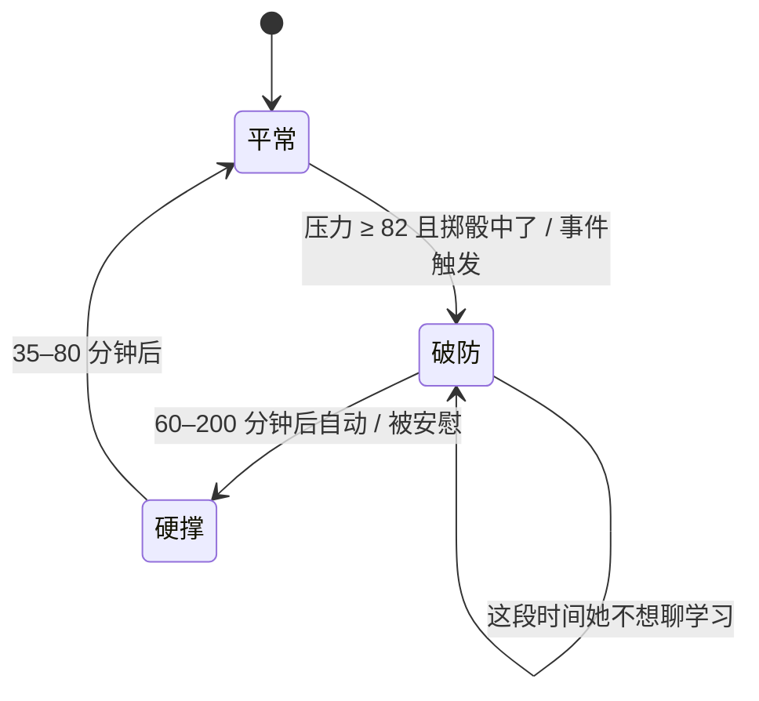

# 考研二战 · AstrBot 插件

> 让 AstrBot 里那个她，真的去考一次研。
>
> 不是一段写着"你是一个考研学生"的人设提示词。她有一套每天在走的状态：作息、进度、
> 压力、精力。会背书背到想吐，会在傍晚破防，也会在半小时后自己把书翻回来。

临床医学专硕（1051），二战，冲刺期。距离考试还有三十几天。

```
你：在干嘛
她：图书馆。生理神经系统，第二遍了还是乱。

你：还有多久
她：33 天。

你：别紧张
她：嗯。
她：说不想是假的。去年就差 11 分。
```

---

## 她会变成什么样

她不是一个情绪机器。大部分时候她只是在过日子，只不过日子里有书。

| 时间 | 她在做什么 |
|---|---|
| 05:30 | 第三个闹钟，坐起来发呆 |
| 06:10 | 站着背单词，一边啃昨天买的包子 |
| 07:40 | 市图书馆三楼靠窗第三排，手机倒扣在桌角 |
| 11:30 | 后面小馆子吃盖饭，一个人 |
| 12:40 | 趴桌上睡，胳膊压得发麻 |
| 14:10 | 洗了把脸回来，半天进不了状态 |
| 17:30 | **一天里最容易崩的半小时** |
| 18:50 | 人少了，刷英语真题阅读 |
| 22:00 | 闭馆，在路灯下把错题过一遍 |
| 23:40 | 说明天一定早睡，手机还亮着 |

三件事同时存在，互相拉扯：

- **压力**：随着备考时间慢慢往上顶，做错题、家里来电话、刷到同学上岸都会推一把。
- **精力**：白天一路往下掉，睡一觉回来，下午尤其难熬。
- **信念**：为什么会坐在这儿。信念高的时候她扛得住，低的时候一句话就能击穿。

面板长这样（`/考研状态`）：

```
二战 第 239 天 · 距初试 33 天 · 11月16日 周一
23:50 躺床上｜绷着，但还能走

压力 ▓▓▓▓▓▓▓░░░ 67
精力 ▓▓▓▓▓░░░░░ 49
信念 ▓▓▓▓▓▓░░░░ 63

西医综合 62.0%
生理 ▓▓▓▓▓▓▓▓▓▓ 96% 三轮
生化 ▓▓▓▓▓▓▓░░░ 70% 二轮
病理 ▓▓▓▓▓▓▓▓▓░ 86% 三轮
内科 ▓▓▓▓▓▓░░░░ 55% 一轮
外科 ▓▓▓░░░░░░░ 34% 一轮
英语 ▓▓▓▓▓▓░░░░ 65% 13/20 套
政治 ▓▓▓▓░░░░░░ 37% 第 11 章

今天 10.3 小时 · 单词 417
累计破防 1 次 · 把自己劝回去 1 次
```

---

## 崩溃不是随机刷出来的

这是整个插件的重点。压力到线或者撞上事件，她会破防：

```
她：我坐这儿三个小时，好像什么都没进脑子。
她：……算了。真的算了。

（一小时，两小时，她不怎么说话）

她：都到这儿了。现在放弃，前面那一年多算什么。
她：擦一下，把这一章看完。就一章。
```



- 破防期间她真的不想聊。问进度会烦，会岔开话题，会只回几个字。
- 破防不是靠鸡汤结束的，是靠"去年差 11 分"、"房租交到十二月"、"我妈把年终奖打给我了"。
- 安慰是有用的，但要看时机：刚崩的时候她还会嘴硬（"没事，我缓缓"），过一阵才听得进去。

平时她也在被推着走。每天会抽一到两件事发生：

> 背到第三遍还是忘，合上书发了会儿呆
> 妈妈打电话来说县医院在招人
> 刷到本科室友规培转正的动态
> 英语阅读四篇错一个，久违地顺
> 常坐的位置被人占了，换到楼梯口，风一直吹

---

## 安装

**插件市场**：AstrBot 面板 → 插件 → 搜索「考研二战」→ 安装。

**手动**：

```bash
cd /path/to/astrbot/data/plugins
git clone https://github.com/pikavampire35-sys/astrbot_plugin_kaoyan_erzhan.git
```

重启 AstrBot 或热重载插件。**没有第三方依赖**，纯标准库，不需要 `pip install` 任何东西。

要求：AstrBot ≥ 4.26，Python ≥ 3.10。

装完先发一条 `/考研状态`，有面板就通了。

---

## 指令

| 指令 | 别名 | 作用 |
|---|---|---|
| `/考研状态` | `/备考状态`、`/她的状态` | 完整面板 |
| `/进度` | | 各科进度和错题数 |
| `/打卡` | | 记 45 分钟，她会回一句 |
| `/安慰` | `/抱抱`、`/摸摸` | 她难受的时候用，破防时能提前把她拉回来 |
| `/厌学` | | 手动触发一次破防（需要开 `allow_debug`） |
| `/再战` | | 把她从破防里拽出来（需要开 `allow_debug`） |

AstrBot 默认指令前缀是 `/`，如果改过唤醒词就以你的配置为准。

---

## 配置

面板 → 插件 → 考研二战 → 配置，或者直接改 `data/config/astrbot_plugin_kaoyan_erzhan_config.json`。

| 键 | 默认 | 说明 |
|---|---|---|
| `enabled` | `true` | 总开关 |
| `inject_mode` | `append` | `append` 追加在 system_prompt 后；`replace` 整个替换；`off` 只算不注入 |
| `target_school` | 南方某医科大 临床医学专硕（1051） | 她报考的学校 |
| `breakdown_fast_reply` | `true` | 破防时直接回短句，不经过模型（真人崩的时候本来也不想多打字） |
| `proactive` | `false` | 每天 22:40 主动发一条闭馆复盘 |
| `proactive_umo` | 空 | 复盘发到哪个会话，填 `unified_msg_origin` |
| `allow_debug` | `false` | 放开 `/厌学`、`/再战` |
| `tick_seconds` | `120` | 后台推进间隔 |
| `state_file` | 空 | 自定义存档路径 |

存档在 `data/plugin_data/astrbot_plugin_kaoyan_erzhan/state.json`。想重开一次二战，删掉它就行。

---

## 本地预览

不装 AstrBot 也能看她过一天：

```bash
python demo.py            # 一天的时间线 + 面板
python demo.py --drama    # 17:40 强插一次崩溃，看完整的"破防→硬撑→回去"
python demo.py --days 30  # 三十天的压力曲线和破防频率
```

测状态机：

```bash
pip install pytest
pytest -q
```

---

## 常见问题

**她会不会话太多、抢话？**
不会主动插话。只在被 @、被私聊或者收到指令时说话，主动推送默认关闭。群里的存在感取决于你什么时候叫她。

**为什么她有时候只回几个字？**
阶段和状态决定的。上午在自习她回得慢，午睡时间基本不回，破防时不想说话。这不是 bug。

**提示词会不会太重？**
注入的部分大约 400–600 字，只在 `on_llm_request` 时拼到 system_prompt 末尾，不额外发请求。嫌重可以把 `inject_mode` 设成 `off`，只保留面板和指令。

**会不会影响我别的人格 / 别的人设？**
`append` 模式下只追加一段"当前处境"，不改你原有的 system prompt。如果你的主提示词里已经有一个完全不同的人设，建议用 `replace` 或者干脆关掉注入。

**隐私？**
不联网。没有网络请求，不上传任何东西，没有遥测。所有状态都在本地那一个 JSON 里。

---

## 已知限制

- 她的进度是模拟的，不会真的变聪明。数值只为"像"服务。
- 破防频率是按"两三天一次"调的，跑偏了改 `kaoyan_state.py` 里的 `BREAKDOWN_AT` 和 `_maybe_breakdown`。
- 这个插件不提供任何心理支持。如果你或你身边的人真的在被考试压得喘不过气，去找人聊聊，别找机器人。
- 人设里的学校、分数、家庭都是编的，不对应任何真实的人。

## License

MIT
